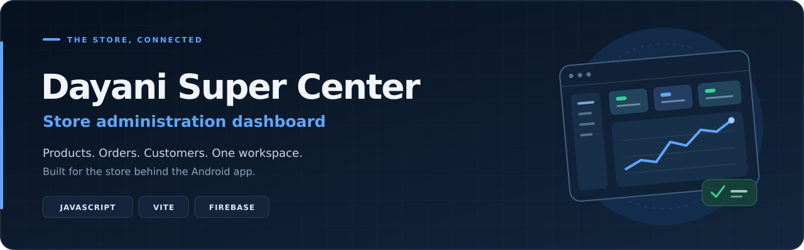

<div align="center">



### One dashboard for the store behind the app


</div>

---

## 📖 Overview

**Dayani Super Center Admin** is a web dashboard for managing the store behind the Dayani Super Center Android application. It brings products, categories, customer records, order fulfilment, reports and customer support into one interface.

The dashboard uses **Firebase Authentication**, **Cloud Firestore** and **Firebase Storage**. Its data is shared with the companion Android application through the same Firebase project.

## ✨ Features

| Feature | What the administrator can do |
| --- | --- |
| Admin sign-in | Sign in with Firebase email/password authentication and a configured admin email |
| Dashboard | View order value, order counts, low-stock products and recent activity |
| Products | Add, edit and delete products; manage price, description, category, stock and visibility |
| Categories | Add, edit and delete categories, including images and display order |
| Catalogue images | Upload supported images to Firebase Storage or provide an image URL |
| Customers | Browse customer records and profile information |
| Orders | View customer orders and move them through fulfilment stages |
| Order updates | Save status history and create customer notifications when a status changes |
| Notifications | Send messages to all customers or selected customers |
| Support chat | Read customer conversations, send replies and track unread messages |
| Reports | View daily order-value charts, status breakdowns and top-selling products |
| Live updates | Refresh order, support and dashboard data with Firestore listeners |

Order stages are **pending → processing → shipped → delivered**. The data service prevents moving orders backwards and changing completed delivered orders.

## 🛠️ Technology Stack

<div align="center">


</div>

| Area | Technologies |
| --- | --- |
| Frontend | HTML, JavaScript ES modules, Sass |
| Interface | Bootstrap 5.3, Tabler Icons, Poppins |
| Charts | ApexCharts |
| Backend | Firebase JavaScript SDK 10.12.5 |
| Services | Firebase Authentication, Cloud Firestore, Firebase Storage |
| Development | Vite 6, Node.js, npm, VS Code |
| Checks | Node.js regression checks with mocked Firebase services |

## 🚀 Getting Started

### Requirements

- Node.js **22.x** with npm.
- VS Code or another code editor.
- A modern browser supporting ES2022.
- Your own Firebase project and an administrator account.

### 1. Install dependencies

Open the repository root containing `package.json` in VS Code, then run:

```bash
npm ci
```

The repository includes `package-lock.json`; keep it committed for repeatable dependency installation.

### 2. Configure Firebase

Copy the supplied template:

```powershell
Copy-Item src/assets/js/firebase-config.example.js src/assets/js/firebase-config.js
```

On macOS or Linux, use `cp` instead of `Copy-Item`. If you already have a working `firebase-config.js`, keep your current file.

Edit **`src/assets/js/firebase-config.js`** with the Firebase web-app configuration from your project. Set **`ADMIN_EMAIL`** to the exact email address of your administrator account.

Then configure your Firebase project:

1. Enable **Email/Password** in Firebase Authentication.
2. Create the administrator account with the email configured above.
3. Set up **Cloud Firestore** and a **Firebase Storage** bucket for uploads.
4. Configure Firestore and Storage rules to enforce administrator access and customer ownership.
5. Use the same Firebase project as the Android application.

The email comparison in the frontend controls the dashboard interface. Server-enforced Firebase rules must protect the actual data. Firebase web-app configuration is visible to the browser at runtime, so keeping its file out of Git is not an authorization mechanism. Firebase deployment rules are not included in this repository.

### 3. Start development

```bash
npm run dev
```

Open **http://localhost:3000/signin.html** and sign in with your configured administrator account. Use the URL printed in the terminal if Vite selects another port.

### 4. Run checks and build

```bash
npm test
npm run build
npm run preview
```

The build is written to **`dist/`**. The preview command serves that build locally; use the address printed in the terminal. The regression checks use mocked Firebase services and do not verify your live project or access rules.

## ⚙️ Available Commands

| Command | Purpose |
| --- | --- |
| `npm ci` | Install dependencies using the lockfile |
| `npm run dev` | Start the Vite development server; configured port is 3000 |
| `npm test` | Run the existing data-service regression checks |
| `npm run build` | Build the multi-page application into `dist/` |
| `npm run preview` | Preview the production build locally |

## 🔗 Shared Backend

| Firebase path | Purpose |
| --- | --- |
| `products` | Product information, prices, stock and image references |
| `categories` | Category information and display settings |
| `users/{uid}` | Customer profiles |
| `users/{uid}/orders` | Customer orders, totals and status history |
| `users/{uid}/notifications` | Store messages and order updates |
| `support_chats/{uid}` | Conversation metadata and unread counts |
| `support_chats/{uid}/messages` | Customer messages and administrator replies |

Product and category uploads use the `products/` and `categories/` prefixes in Firebase Storage.

## 📁 Project Structure

| Path | Purpose |
| --- | --- |
| `src/*.html` | Sign-in, dashboard, products, categories, customers, orders, reports and support pages |
| `src/assets/js/pages/` | Page-specific interface and event logic |
| `src/assets/js/data-service.js` | Firestore operations, uploads, notifications and support messages |
| `src/assets/js/auth.js` | Admin sign-in and session checks |
| `src/assets/js/firebase-config.example.js` | Template for the ignored local Firebase configuration |
| `src/assets/js/dashboard-updates.js` | Dashboard refresh subscriptions |
| `src/assets/js/page-lifecycle.js` | Page cleanup and chart lifecycle helpers |
| `src/assets/scss/` | Styles and Bootstrap customizations |
| `src/assets/images/` | Store branding |
| `tests/data-service.test.mjs` | Existing mocked-service regression checks |
| `vite.config.js` | Development server and multi-page build configuration |
| `docs/readme-banner.svg` | Repository banner |

## 🔧 Troubleshooting

| Issue | Check |
| --- | --- |
| Vite cannot resolve `firebase-config.js` | Copy the example file and enter your Firebase configuration |
| Admin access is denied | Check `ADMIN_EMAIL` and the account in Firebase Authentication |
| Firebase reports insufficient permissions | Review your Firestore and Storage access rules |
| Products or orders do not appear | Confirm both applications use the same Firebase project and data paths |
| Image upload fails | Check the Storage bucket, rules, service availability and selected image type |
| Opening HTML directly does not work | Start the application through Vite using `npm run dev` |

## 🔍 Project Scope

This dashboard manages store data and fulfilment. Revenue-style summaries are calculated from stored order totals; they are not a reconciliation of verified payment-provider settlements. Notifications are stored for the Android app to read; a Firebase Cloud Messaging sender is not included.

This README describes the supplied source. Verify the production build, authentication and service permissions with your own Firebase configuration before deployment.

## 📜 License & Credits

The supplied **[LICENSE](LICENSE)** contains the MIT notice for the Codescandy dashboard template. Preserve that notice when redistributing the template and retain the applicable notices for third-party dependencies.

---

<h3>👨‍💻 Developer</h3>
<p><strong>Vihanga Thathsara</strong></p>
<a href="https://github.com/VihangaThathsara"></a>
<a href="https://www.linkedin.com/in/vihanga-thathsara-00187543b/"></a>
</div>
